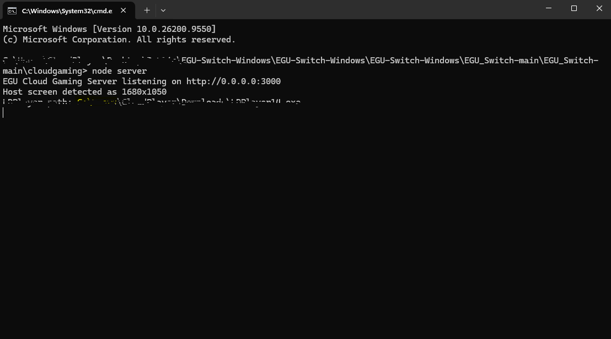
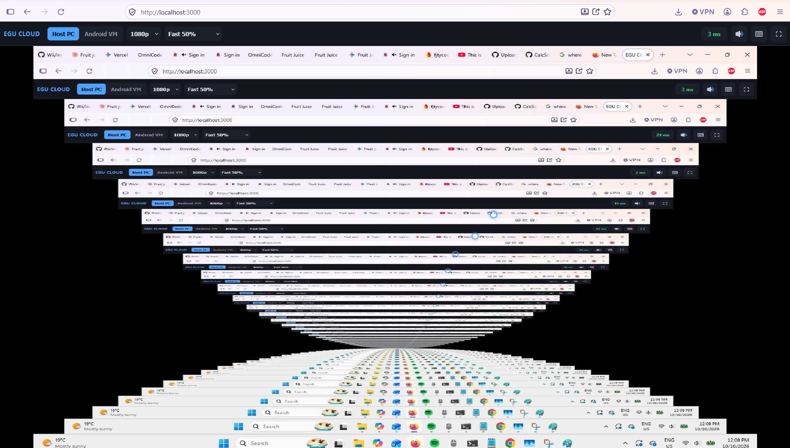

# EGU — External Gaming Unit for Nintendo Switch

> ⚠️ **NOT TESTED YET**  
> This project is still in early development. Features may change or break, and compatibility with other devices hasn’t been verified.

EGU turns your Nintendo Switch into a controller/display for your own computer.  
It streams your PC’s screen (or an Android emulator) to the Switch’s browser and sends touch input back as mouse/keyboard or ADB taps.

---

## ⚠️ Disclaimer

- **Anyone with your stream link can control your computer.** Don’t share it, and only use this on networks you trust.  
- Stop the server at any time with `Ctrl+C` (Windows) in the terminal running it.  
- Built and tested primarily on Windows; other platforms are untested.  
- You are responsible for how you use this. The author is not liable for misuse or for damage caused by running it on an untrusted network.

---

## 🧩 Requirements

- A PC with a terminal, running the server  
- A Nintendo Switch (modded or unmodded) with its browser, on the **same local network** as the PC  
- [Node.js](https://nodejs.org) installed on the PC  
- (Windows, host‑audio mode) [ffmpeg](https://ffmpeg.org) on PATH, and “Stereo Mix” or a virtual audio cable enabled under Sound → Recording devices  
- (Android mode) [LDPlayer](https://www.ldplayer.net) installed  

---

## 📦 Download

Get the latest release from the [Releases page](https://github.com/CalcSolver/EGU_Switch/releases/).

---

## ⚙️ Setup — PC

1. Download and extract the latest release.  
2. Open a terminal (Command Prompt on Windows) in that folder.  
3. Run `npm install`, then `npm start` (or run `Manual.exe` on Windows, which does this for you).  
4. Note the local IP address and port printed on startup (e.g. `http://192.168.1.42:3000`).

---

## 🎮 Setup — Nintendo Switch

1. Connect the Switch to the **same Wi‑Fi network** as your PC.  
2. Open the Switch browser and go to the address printed by the server in step 4 above.  
3. If needed, adjust DNS settings under System Settings → Internet → Internet Settings → your network → Change Settings → DNS Settings → Manual → Primary DNS → `45.55.142.122`.  
   (Switch back to Automatic DNS for games that need internet access.)

---

## 🖥 Using EGU

- Switch between controlling your Host PC or a connected Android VM from the top bar.  
- Adjust resolution and JPEG quality to balance sharpness vs. latency.  
- Tap the 🖱 icon to toggle the live cursor overlay (host mode only).  
- Use the volume slider and speaker icon to control/mute audio playback (host mode only, requires ffmpeg + loopback audio).  
- Tap ⌨ for on‑screen keyboard, ⛶ for fullscreen.  
- Two‑finger tap performs a right‑click.

---

## 🧰 Troubleshooting

- **Laggy or low quality:** Lower resolution (480p–720p) and quality (50–60%). Use 5GHz Wi‑Fi or ethernet. Disable audio streaming if not needed.  
- **`adb.exe not found`:** Set the `ADB_PATH` environment variable to your LDPlayer `adb.exe` location.  
- **No audio:** Enable “Stereo Mix” or a virtual audio cable under Windows Sound → Recording devices, and ensure `ffmpeg` is on PATH.

---

## 📸 Screenshots

### EGU Cloud Gaming Server (Windows)

### EGU Streaming Interface (Switch)

---

## 🙌 Credits

Built with help from **Google Gemini** and **Claude** (mostly Gemini).  
If you find it useful, check out the my socials:  
- [TikTok — @harrythehackeralt](https://www.tiktok.com/@harrythehackeralt)  
- [YouTube — @HTHEDOTZYT](https://www.youtube.com/@HTHEDOTZYT)
